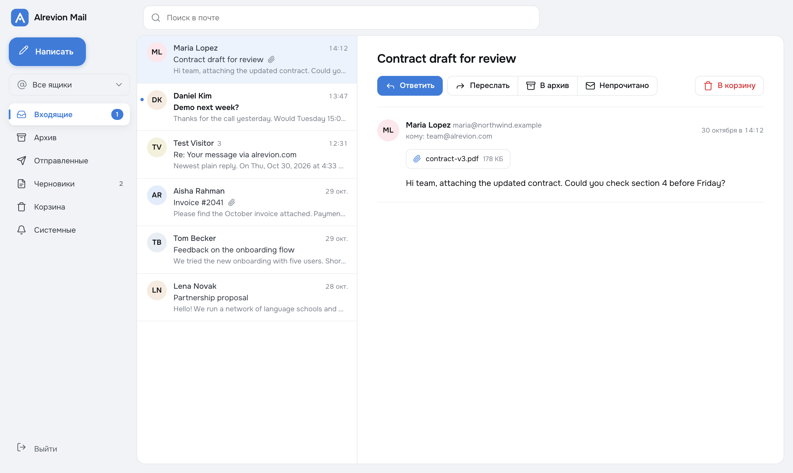
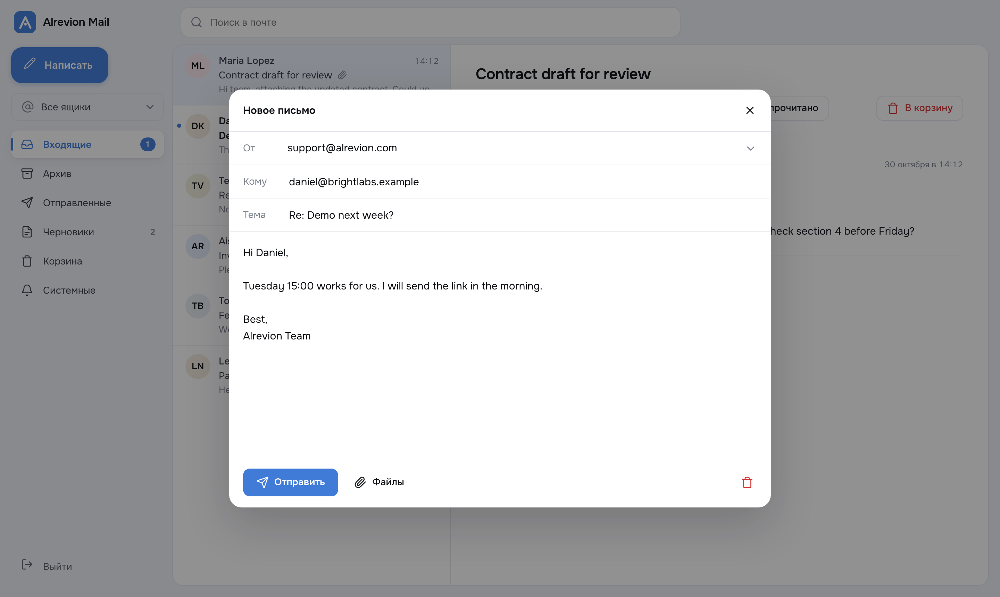
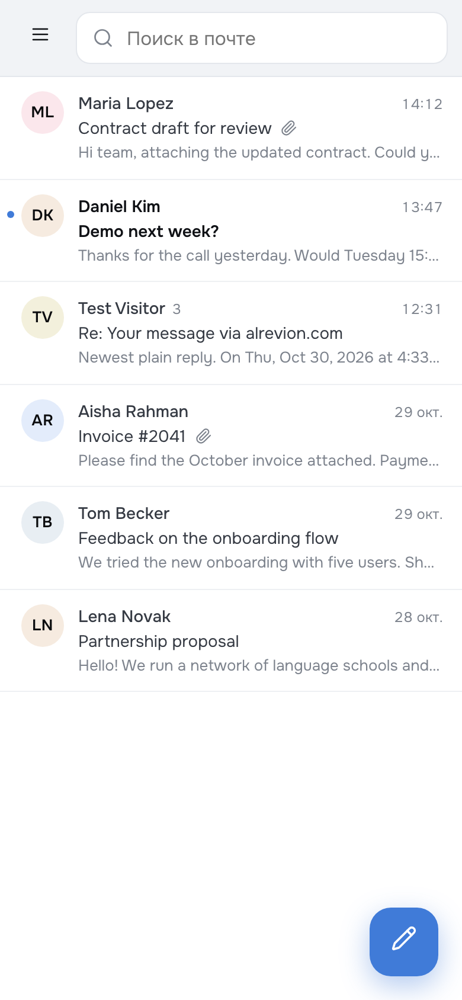
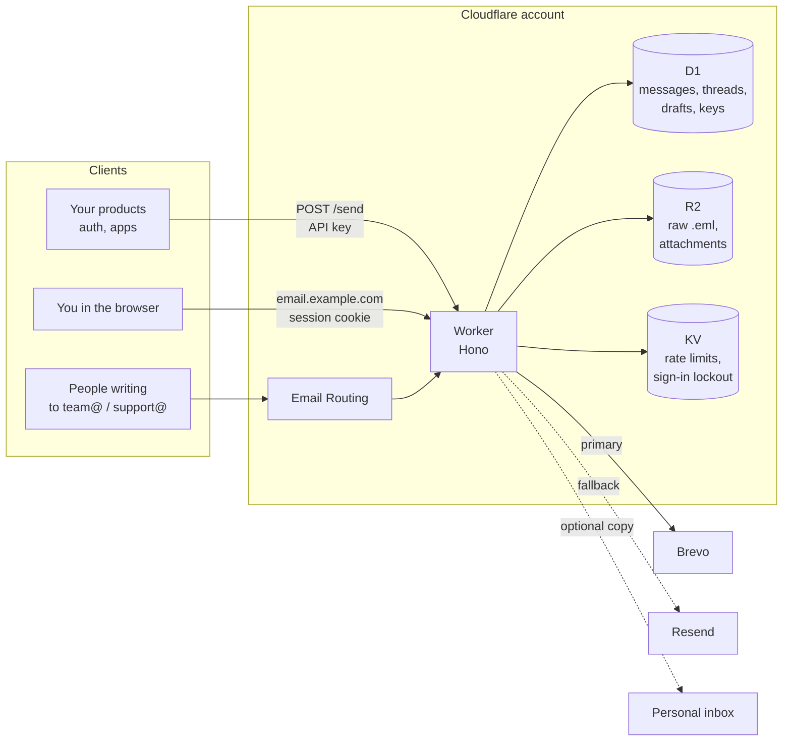
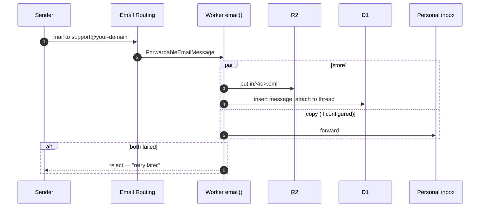
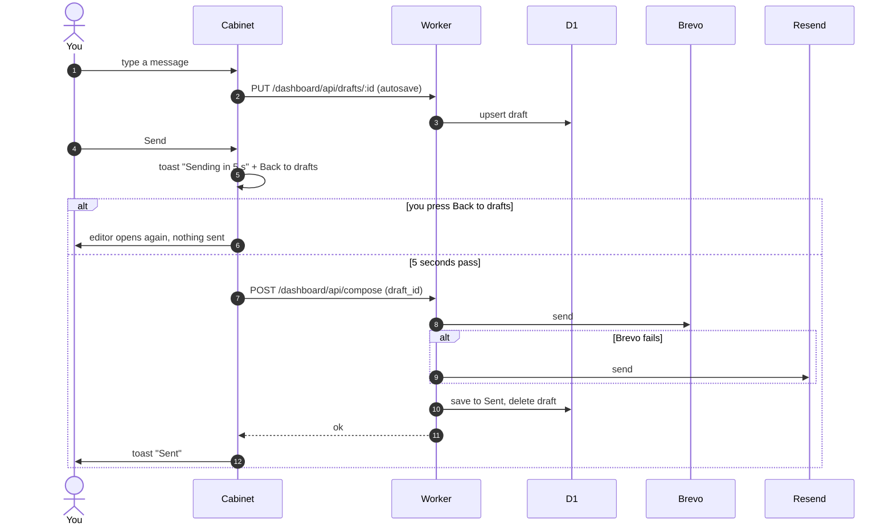
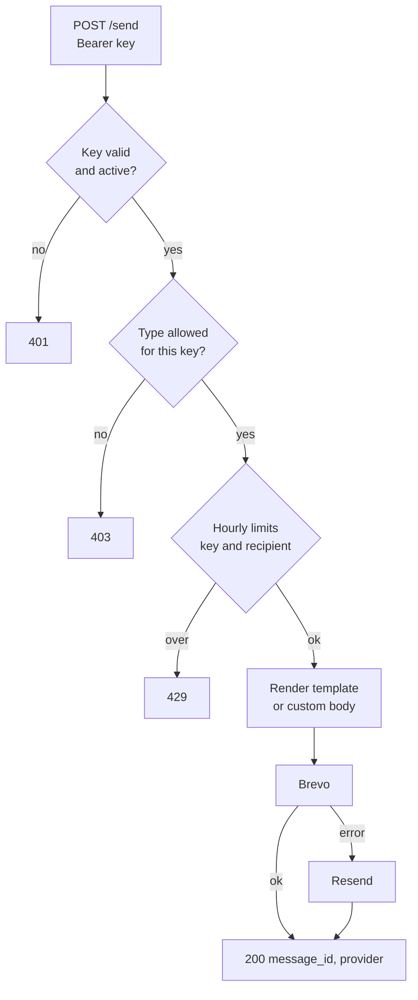

# Alrevion Mail — email on Cloudflare Workers

**English** · [Русский](README.ru.md)

[](LICENSE)
[](https://workers.cloudflare.com)
[](https://hono.dev)

One small Worker that covers all the email a small company needs, without a mail server:

- **Send API** for your products: one-time codes, password resets, email verification and custom
  messages from `noreply@`, with scoped API keys and an automatic Brevo → Resend fallback.
- **Inbound mail** for `team@`, `support@` and any other address on your domain through Cloudflare
  Email Routing: the full message is stored in your own D1 + R2 and can be forwarded to a
  personal inbox.
- **A webmail cabinet** at the root of the domain: threads, folders, search, attachments, drafts,
  replies and forwards, and a 5-second undo after **Send**.

Everything runs on the Cloudflare free plan. The data stays in your account.



---

## Table of contents

1. [Features](#features)
2. [How it looks](#how-it-looks)
3. [How it works](#how-it-works)
4. [Tech stack](#tech-stack)
5. [Deploy](#deploy)
6. [Configuration](#configuration)
7. [Local development](#local-development)
8. [API](#api)
9. [Project structure](#project-structure)
10. [Security](#security)
11. [Troubleshooting](#troubleshooting)
12. [License](#license)

---

## Features

**Webmail cabinet**

- Mailboxes for several addresses at once, with an **All mailboxes** switch.
- Folders: Inbox, Archive, Sent, Drafts, Trash, and System (the transactional mail the API sent).
- Conversations are grouped into threads by `Message-ID`, `In-Reply-To` and `References`.
  Quoted history is folded behind **Show quote**.
- Search by sender, subject and message preview.
- HTML mail opens in a sandboxed frame with a strict CSP. Remote images stay blocked until you
  allow them for that message.
- Reply, forward (the original attachments go along) and new messages from any allowed sender
  address. Up to 10 attachments, 10 MB in total.
- **Drafts** save on their own while you type. If you close the tab, the draft is still there.
- **Undo send.** After **Send**, a toast in the bottom-left corner counts down 5 seconds with a
  **Back to drafts** button, then shows *Sending* → *Sent* or *Not sent* with the reason.
- Works on phones: side drawer, compose button, full-screen editor. Light and dark themes follow
  the system setting.
- Sign-in with a login and password. After two wrong attempts the IP is blocked for 24 hours.

**Send API**

- `POST /send` with a per-service API key. Each key is limited to the message types it may send
  (`otp`, `reset`, `verify`, `custom`) and to a number of messages per hour.
- Built-in bilingual templates (Russian and English) for codes, resets and verification links.
  Verification links are accepted only from allowlisted HTTPS origins.
- Brevo is tried first, Resend takes over if Brevo fails. The order is configurable.
- A per-recipient hourly cap protects against abuse.
- Bodies of code, reset and verification emails are never stored.

**Inbound**

- Cloudflare Email Routing hands every message to the Worker's `email()` handler.
- The raw `.eml` goes to R2 and is parsed with `postal-mime`. Metadata and threading go to D1.
- An optional copy is forwarded to a personal address. If both storing and forwarding fail, the
  message is rejected, so the sender learns it was not delivered. Mail is never silently lost.

## How it looks

| Compose | Phone |
|---|---|
|  |  |

The cabinet is a single page with no build step and no framework: it uses the Onest font, Lucide
icons, a light-grey backdrop with white panels and one blue accent (`#407bd8`). The interface is
in Russian for now.

## How it works

### The big picture



### Incoming message



### Sending from the cabinet, with undo



### Send API for products



## Tech stack

| Layer | Choice | Why |
|---|---|---|
| Runtime | Cloudflare Workers | Free tier, no servers, native Email Routing |
| Router | Hono 4 | Tiny, typed, made for Workers |
| Database | Cloudflare D1 (SQLite) | Messages, threads, drafts, API keys, audit log |
| Files | Cloudflare R2 | Raw inbound `.eml` and sent attachments, 10 GB free |
| Counters | Cloudflare KV | Rate limits and sign-in lockout |
| MIME parsing | postal-mime | Pure JS, runs inside the Worker |
| Outbound | Brevo, Resend | Two providers, automatic fallback |
| Cabinet | Vanilla HTML/CSS/JS | One file, served by the Worker, no build step |
| Tests | Vitest | Providers, templates, keys, mailbox helpers, drafts |

## Deploy

You need a Cloudflare account with your domain on it, Node.js 18+, and at least one of
[Brevo](https://www.brevo.com) or [Resend](https://resend.com) with the domain verified there.

**1. Clone and install**

```bash
git clone https://github.com/alrevion/email-api.git
cd email-api
npm install
npx wrangler login
```

**2. Create storage**

```bash
npx wrangler d1 create email-api-db
npx wrangler r2 bucket create email-api-mail
npx wrangler kv namespace create RATE_LIMIT
```

Put the printed IDs into `wrangler.toml` (`account_id`, `database_id`, the KV `id`), and set the
`[vars]` section to your domain: `NOREPLY_ADDRESS`, `TEAM_ADDRESS`, `DASHBOARD_SENDERS`, and the
`[[routes]]` patterns. Then apply the migrations:

```bash
npm run d1:migrate-remote
```

**3. Set secrets**

```bash
npx wrangler secret put API_KEY_PEPPER       # any long random string
npx wrangler secret put ADMIN_API_SECRET     # guards /admin/*
npx wrangler secret put BREVO_API_KEY
npx wrangler secret put RESEND_API_KEY
npx wrangler secret put DASHBOARD_LOGIN
npx wrangler secret put DASHBOARD_PASSWORD
npx wrangler secret put PERSONAL_FORWARD_ADDR   # optional
```

**4. Deploy**

```bash
npm run deploy
```

Cloudflare attaches DNS and a certificate to each `custom_domain` route on the first deploy.
Open `https://<your cabinet domain>/` and sign in.

**5. Route inbound mail**

In the Cloudflare dashboard: **Email → Email Routing → Routes**. For each address
(`team@`, `support@`, …) choose **Send to a Worker → api-email**. If you set
`PERSONAL_FORWARD_ADDR`, add it under **Destination addresses** and confirm it first.

**6. DNS for sending**

Add the SPF, DKIM and DMARC records that Brevo and Resend show for your domain. Without them,
mail lands in spam. Check the result with [mail-tester.com](https://www.mail-tester.com).

**7. Issue a key for a product**

```bash
curl -X POST https://<api domain>/admin/services \
  -H "Authorization: Bearer $ADMIN_API_SECRET" -H "Content-Type: application/json" \
  -d '{"name":"auth","allowed_types":["otp","reset"]}'
```

The response holds the API key once. Store it in that product's secrets.

## Configuration

**Variables** (`[vars]` in `wrangler.toml`)

| Name | Example | Meaning |
|---|---|---|
| `NOREPLY_ADDRESS`, `NOREPLY_NAME` | `noreply@example.com` | Sender for `/send` |
| `TEAM_ADDRESS`, `TEAM_NAME` | `team@example.com` | Sender for owner replies |
| `DASHBOARD_SENDERS` | `team@example.com,support@example.com` | Addresses the cabinet may send from |
| `DASHBOARD_SESSION_TTL_HOURS` | `12` | Cabinet session length |
| `EMAIL_PROVIDER_ORDER` | `brevo,resend` | Provider order |
| `SEND_PER_RECIPIENT_PER_HOUR` | `10` | Cap per recipient, `0` turns it off |
| `DEFAULT_KEY_LIMIT_PER_HOUR` | `500` | Default cap per API key |
| `VERIFY_URL_ALLOWED_ORIGINS` | `https://auth.example.com` | Origins allowed in verification links |
| `CABINET_URL` | `https://mail.example.com` | Where the API-only host sends cabinet visitors |
| `API_ONLY_HOST` | `api.mail.example.com` | Host that serves only the API; leave empty if you have one domain |

**Secrets** (`wrangler secret put`)

| Name | Required | Meaning |
|---|---|---|
| `API_KEY_PEPPER` | yes | HMAC pepper for hashing API keys |
| `ADMIN_API_SECRET` | yes | Bearer token for `/admin/*` |
| `BREVO_API_KEY`, `RESEND_API_KEY` | at least one | Outbound providers |
| `DASHBOARD_LOGIN`, `DASHBOARD_PASSWORD` | for the cabinet | Cabinet sign-in |
| `PERSONAL_FORWARD_ADDR` | no | Copy of every inbound message goes here |

## Local development

```bash
cp .dev.vars.example .dev.vars   # local values only
npm run d1:migrate-local
npm run dev                       # http://localhost:8787
npm test
npm run typecheck
```

Without provider keys, sends fail with `no_email_provider_configured`. That is enough to try
drafts, undo and the error toast.

## API

| Method | Path | Auth | Purpose |
|---|---|---|---|
| GET | `/health` | — | Liveness |
| GET | `/ready` | — | D1 readiness |
| POST | `/send` | service key | Send from `noreply@` |
| GET | `/inbound`, `/inbound/:id` | owner key | Read inbound mail |
| POST | `/reply` | owner key | Threaded reply from `team@` |
| POST | `/admin/services` | `ADMIN_API_SECRET` | Issue a key |
| POST | `/admin/services/:id/rotate-key` | `ADMIN_API_SECRET` | Rotate a key |
| PATCH | `/admin/services/:id` | `ADMIN_API_SECRET` | Change active flag, types, role |
| GET | `/admin/services/:id` | `ADMIN_API_SECRET` | Key info |
| POST | `/admin/dashboard/unblock` | `ADMIN_API_SECRET` | Lift a sign-in IP block |
| GET | `/` | — | Cabinet |
| * | `/dashboard/api/*` | session cookie | Cabinet API: list, thread, drafts, compose, attachments |

`POST /send`:

```jsonc
{ "type": "otp", "to": "user@example.com", "template": "otp",
  "vars": { "code": "123456", "ttl_minutes": 10 } }
// custom: { "type": "custom", "to": "…", "subject": "…", "html": "…", "text": "…" }
```

Response: `{ "ok": true, "message_id": "…", "provider": "brevo", "fallback_used": false }`.

## Project structure

```
src/
├── index.ts            routes, cabinet at "/", Email Routing handler, RPC entrypoint
├── config.ts           typed env
├── auth.ts, crypto.ts  API keys (HMAC with pepper), owner/admin checks
├── db.ts               services, sends, audit log
├── mailbox.ts          inbound ingest (R2 + postal-mime), threads, folders, search
├── drafts.ts           draft validation and storage
├── rate-limit.ts       KV hour buckets
├── providers/          Brevo, Resend, fallback chain
├── templates/          otp / reset / verify (RU + EN)
├── routes/             send, reply, admin, dashboard
└── dashboard/          ui.ts (the whole cabinet), session.ts, lockout.ts
migrations/             D1 schema, applied in order
tests/                  Vitest
```

## Security

- API keys are stored only as HMAC hashes. The plain key is shown once, at issue time.
- Each key is scoped to message types and has its own hourly cap.
- The cabinet session is a signed, `HttpOnly`, `Secure`, `SameSite` cookie. Login and password
  are compared in constant time. Two wrong attempts block the IP for 24 hours.
- Inbound HTML renders in a sandboxed `iframe` with no scripts, a strict CSP and no referrer.
  Remote images load only after you allow them.
- Code, reset and verification bodies are never written to the database; other send records are
  pruned after 30 days.
- Secrets live in Worker secrets, never in `wrangler.toml` or the repo.

Found a vulnerability? Please email `team@alrevion.com` instead of opening a public issue.

## Troubleshooting

| Symptom | Fix |
|---|---|
| *Not sent: no_email_provider_configured* | Set `BREVO_API_KEY` or `RESEND_API_KEY` |
| Mail goes to spam | Add SPF, DKIM, DMARC for the sending domain |
| Inbound mail does not appear | Check the Email Routing route points to this Worker |
| Forwarding fails | Confirm `PERSONAL_FORWARD_ADDR` in Email Routing → Destination addresses |
| Sign-in blocked | Wait 24 h or call `POST /admin/dashboard/unblock` |

## License

[MIT](LICENSE) © Alrevion
