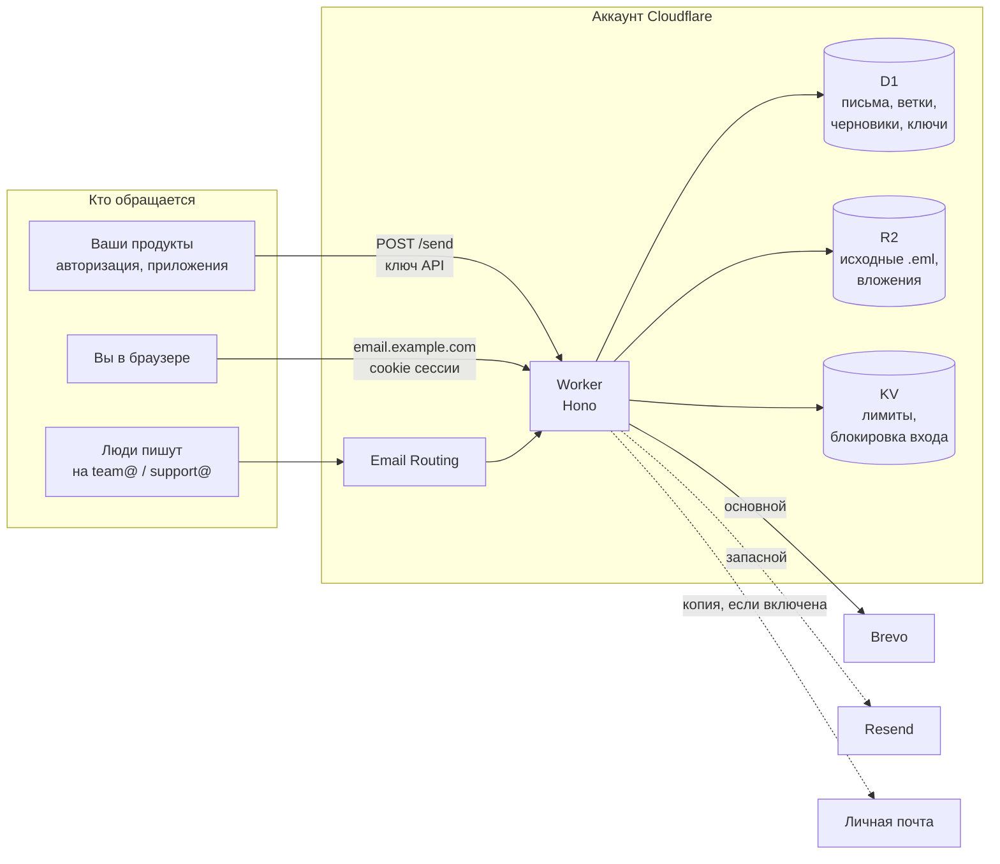
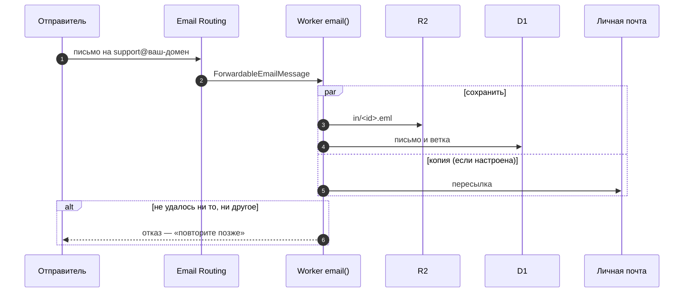
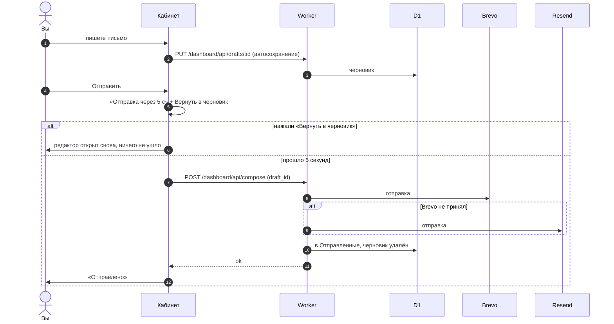
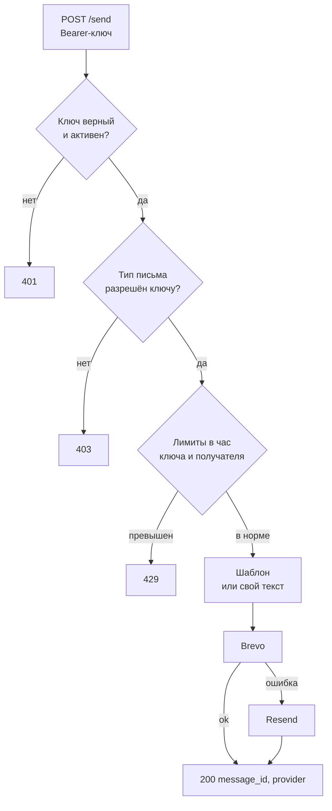

# Alrevion Mail — почта на Cloudflare Workers

[English](README.md) · **Русский**

[](LICENSE)
[](https://workers.cloudflare.com)
[](https://hono.dev)

Один небольшой Worker закрывает всю почту небольшой компании, без почтового сервера:

- **API отправки** для ваших продуктов: коды входа, сброс пароля, подтверждение почты и
  произвольные письма с `noreply@`. Ключи с ограничениями, автоматический переход Brevo → Resend.
- **Входящие** на `team@`, `support@` и любые адреса вашего домена через Cloudflare Email Routing:
  письмо целиком хранится в ваших D1 и R2, копию можно пересылать на личную почту.
- **Веб-почта** в корне домена: ветки, папки, поиск, вложения, черновики, ответ и пересылка,
  5 секунд на отмену после **Отправить**.

Всё работает на бесплатном тарифе Cloudflare. Данные остаются в вашем аккаунте.


---

## Оглавление

1. [Возможности](#возможности)
2. [Как выглядит](#как-выглядит)
3. [Как это устроено](#как-это-устроено)
4. [Технологии](#технологии)
5. [Развёртывание](#развёртывание)
6. [Настройки](#настройки)
7. [Локальная разработка](#локальная-разработка)
8. [API](#api)
9. [Структура проекта](#структура-проекта)
10. [Безопасность](#безопасность)
11. [Частые проблемы](#частые-проблемы)
12. [Лицензия](#лицензия)

---

## Возможности

**Веб-почта**

- Несколько ящиков сразу и переключатель **Все ящики**.
- Папки: Входящие, Архив, Отправленные, Черновики, Корзина и Системные (служебные письма,
  которые отправил API).
- Переписка собирается в ветки по `Message-ID`, `In-Reply-To` и `References`. Цитата прошлых
  писем свёрнута под **Показать цитату**.
- Поиск по отправителю, теме и началу письма.
- HTML-письма открываются в изолированном фрейме со строгой CSP. Внешние картинки загружаются,
  только когда вы разрешите их для этого письма.
- Ответ, пересылка (вложения оригинала уходят вместе с письмом) и новое письмо с любого
  разрешённого адреса. До 10 вложений, всего до 10 МБ.
- **Черновики** сохраняются сами, пока вы пишете. Закрыли вкладку — черновик на месте.
- **Отмена отправки.** После **Отправить** в левом нижнем углу 5 секунд идёт отсчёт с кнопкой
  **Вернуть в черновик**, затем статус *Отправляется* → *Отправлено* или *Не отправлено* с причиной.
- Удобно на телефоне: боковое меню, кнопка нового письма, редактор на весь экран. Светлая и
  тёмная темы — по настройке системы.
- Вход по логину и паролю. После двух неверных попыток IP блокируется на 24 часа.

**API отправки**

- `POST /send` с ключом сервиса. Ключу разрешены только свои типы писем (`otp`, `reset`,
  `verify`, `custom`) и своё число писем в час.
- Встроенные двуязычные шаблоны (русский и английский) для кодов, сброса и подтверждения.
  Ссылки подтверждения принимаются только с разрешённых HTTPS-адресов.
- Сначала Brevo, при ошибке — Resend. Порядок настраивается.
- Лимит писем одному получателю в час защищает от злоупотреблений.
- Тексты писем с кодами, сбросом и подтверждением не сохраняются.

**Входящие**

- Cloudflare Email Routing передаёт каждое письмо в обработчик `email()` Worker'а.
- Исходный `.eml` ложится в R2 и разбирается `postal-mime`, данные и ветки — в D1.
- Копию можно пересылать на личный адрес. Если не удалось ни сохранить, ни переслать, письмо
  отклоняется, и отправитель узнаёт, что оно не дошло. Молча почта не теряется.

## Как выглядит

| Новое письмо | Телефон |
|---|---|
|  |  |

Кабинет — одна страница без сборки и фреймворков: шрифт Onest, иконки Lucide, светло-серый фон,
белые панели и один синий акцент (`#407bd8`). Интерфейс пока на русском.

## Как это устроено

### Общая схема



### Входящее письмо



### Отправка из кабинета с отменой



### API отправки для продуктов



## Технологии

| Слой | Выбор | Зачем |
|---|---|---|
| Среда | Cloudflare Workers | Бесплатно, без серверов, встроенный Email Routing |
| Маршрутизация | Hono 4 | Маленький, типизированный, сделан под Workers |
| База | Cloudflare D1 (SQLite) | Письма, ветки, черновики, ключи, журнал |
| Файлы | Cloudflare R2 | Исходные `.eml` и вложения, 10 ГБ бесплатно |
| Счётчики | Cloudflare KV | Лимиты и блокировка входа |
| Разбор MIME | postal-mime | Чистый JS, работает внутри Worker'а |
| Отправка | Brevo, Resend | Два провайдера, автоматический переход |
| Кабинет | HTML/CSS/JS без фреймворков | Один файл, отдаёт Worker, без сборки |
| Тесты | Vitest | Провайдеры, шаблоны, ключи, почтовый ящик, черновики |

## Развёртывание

Нужны аккаунт Cloudflare с вашим доменом, Node.js 18+ и хотя бы один из
[Brevo](https://www.brevo.com) или [Resend](https://resend.com) с подтверждённым доменом.

**1. Клонировать и установить**

```bash
git clone https://github.com/alrevion/email-api.git
cd email-api
npm install
npx wrangler login
```

**2. Создать хранилища**

```bash
npx wrangler d1 create email-api-db
npx wrangler r2 bucket create email-api-mail
npx wrangler kv namespace create RATE_LIMIT
```

Впишите выданные ID в `wrangler.toml` (`account_id`, `database_id`, `id` у KV), а в `[vars]`
укажите свой домен: `NOREPLY_ADDRESS`, `TEAM_ADDRESS`, `DASHBOARD_SENDERS` и шаблоны в
`[[routes]]`. Затем примените миграции:

```bash
npm run d1:migrate-remote
```

**3. Задать секреты**

```bash
npx wrangler secret put API_KEY_PEPPER       # любая длинная случайная строка
npx wrangler secret put ADMIN_API_SECRET     # защищает /admin/*
npx wrangler secret put BREVO_API_KEY
npx wrangler secret put RESEND_API_KEY
npx wrangler secret put DASHBOARD_LOGIN
npx wrangler secret put DASHBOARD_PASSWORD
npx wrangler secret put PERSONAL_FORWARD_ADDR   # необязательно
```

**4. Задеплоить**

```bash
npm run deploy
```

При первом деплое Cloudflare сам подключит DNS и сертификат к каждому маршруту `custom_domain`.
Откройте `https://<домен кабинета>/` и войдите.

**5. Направить входящую почту**

В панели Cloudflare: **Email → Email Routing → Routes**. Для каждого адреса (`team@`,
`support@`, …) выберите **Send to a Worker → api-email**. Если задан `PERSONAL_FORWARD_ADDR`,
сначала добавьте и подтвердите его в **Destination addresses**.

**6. DNS для отправки**

Добавьте записи SPF, DKIM и DMARC, которые Brevo и Resend показывают для вашего домена. Без них
письма попадают в спам. Проверить можно на [mail-tester.com](https://www.mail-tester.com).

**7. Выдать ключ продукту**

```bash
curl -X POST https://<домен API>/admin/services \
  -H "Authorization: Bearer $ADMIN_API_SECRET" -H "Content-Type: application/json" \
  -d '{"name":"auth","allowed_types":["otp","reset"]}'
```

Ключ показывается в ответе один раз. Сохраните его в секретах продукта.

## Настройки

**Переменные** (`[vars]` в `wrangler.toml`)

| Имя | Пример | Значение |
|---|---|---|
| `NOREPLY_ADDRESS`, `NOREPLY_NAME` | `noreply@example.com` | Отправитель для `/send` |
| `TEAM_ADDRESS`, `TEAM_NAME` | `team@example.com` | Отправитель ответов владельца |
| `DASHBOARD_SENDERS` | `team@example.com,support@example.com` | С каких адресов можно писать из кабинета |
| `DASHBOARD_SESSION_TTL_HOURS` | `12` | Длина сессии кабинета |
| `EMAIL_PROVIDER_ORDER` | `brevo,resend` | Порядок провайдеров |
| `SEND_PER_RECIPIENT_PER_HOUR` | `10` | Лимит на получателя, `0` — выключен |
| `DEFAULT_KEY_LIMIT_PER_HOUR` | `500` | Лимит ключа по умолчанию |
| `VERIFY_URL_ALLOWED_ORIGINS` | `https://auth.example.com` | Разрешённые адреса в ссылках подтверждения |
| `CABINET_URL` | `https://mail.example.com` | Куда домен «только API» отправляет посетителей кабинета |
| `API_ONLY_HOST` | `api.mail.example.com` | Домен только для API; пусто, если домен один |

**Секреты** (`wrangler secret put`)

| Имя | Нужен | Значение |
|---|---|---|
| `API_KEY_PEPPER` | да | Соль HMAC для хеширования ключей |
| `ADMIN_API_SECRET` | да | Bearer-токен для `/admin/*` |
| `BREVO_API_KEY`, `RESEND_API_KEY` | хотя бы один | Провайдеры отправки |
| `DASHBOARD_LOGIN`, `DASHBOARD_PASSWORD` | для кабинета | Вход в кабинет |
| `PERSONAL_FORWARD_ADDR` | нет | Сюда уходит копия каждого входящего |

## Локальная разработка

```bash
cp .dev.vars.example .dev.vars   # только локальные значения
npm run d1:migrate-local
npm run dev                       # http://localhost:8787
npm test
npm run typecheck
```

Без ключей провайдеров отправка завершается ошибкой `no_email_provider_configured` — этого хватает,
чтобы проверить черновики, отмену и уведомление об ошибке.

## API

| Метод | Путь | Доступ | Назначение |
|---|---|---|---|
| GET | `/health` | — | Жив ли сервис |
| GET | `/ready` | — | Готовность D1 |
| POST | `/send` | ключ сервиса | Отправка с `noreply@` |
| GET | `/inbound`, `/inbound/:id` | ключ владельца | Чтение входящих |
| POST | `/reply` | ключ владельца | Ответ в ветку с `team@` |
| POST | `/admin/services` | `ADMIN_API_SECRET` | Выдать ключ |
| POST | `/admin/services/:id/rotate-key` | `ADMIN_API_SECRET` | Сменить ключ |
| PATCH | `/admin/services/:id` | `ADMIN_API_SECRET` | Активность, типы, роль |
| GET | `/admin/services/:id` | `ADMIN_API_SECRET` | Данные ключа |
| POST | `/admin/dashboard/unblock` | `ADMIN_API_SECRET` | Снять блокировку входа с IP |
| GET | `/` | — | Кабинет |
| * | `/dashboard/api/*` | cookie сессии | API кабинета: список, ветка, черновики, отправка, вложения |

`POST /send`:

```jsonc
{ "type": "otp", "to": "user@example.com", "template": "otp",
  "vars": { "code": "123456", "ttl_minutes": 10 } }
// свой текст: { "type": "custom", "to": "…", "subject": "…", "html": "…", "text": "…" }
```

Ответ: `{ "ok": true, "message_id": "…", "provider": "brevo", "fallback_used": false }`.

## Структура проекта

```
src/
├── index.ts            маршруты, кабинет на "/", обработчик Email Routing, RPC
├── config.ts           типизированные переменные
├── auth.ts, crypto.ts  ключи API (HMAC с солью), проверки владельца и админа
├── db.ts               сервисы, отправки, журнал
├── mailbox.ts          приём входящих (R2 + postal-mime), ветки, папки, поиск
├── drafts.ts           проверка и хранение черновиков
├── rate-limit.ts       часовые счётчики в KV
├── providers/          Brevo, Resend, цепочка с запасным
├── templates/          otp / reset / verify (RU + EN)
├── routes/             send, reply, admin, dashboard
└── dashboard/          ui.ts (весь кабинет), session.ts, lockout.ts
migrations/             схема D1, применяется по порядку
tests/                  Vitest
```

## Безопасность

- Ключи API хранятся только как HMAC-хеши. Сам ключ показывается один раз, при выдаче.
- Каждому ключу разрешены свои типы писем и свой лимит в час.
- Сессия кабинета — подписанная cookie с `HttpOnly`, `Secure`, `SameSite`. Логин и пароль
  сравниваются за постоянное время. Две неверные попытки — блокировка IP на 24 часа.
- HTML входящих писем показывается в изолированном `iframe` без скриптов, со строгой CSP и без
  referrer. Внешние картинки — только после разрешения.
- Тексты писем с кодами, сбросом и подтверждением в базу не пишутся; остальные записи об
  отправке удаляются через 30 дней.
- Секреты хранятся в секретах Worker'а, не в `wrangler.toml` и не в репозитории.

Нашли уязвимость? Напишите на `team@alrevion.com`, не открывайте публичный issue.

## Частые проблемы

| Что видно | Что сделать |
|---|---|
| *Не отправлено: no_email_provider_configured* | Задайте `BREVO_API_KEY` или `RESEND_API_KEY` |
| Письма в спаме | Добавьте SPF, DKIM, DMARC для домена отправки |
| Входящие не появляются | Проверьте, что маршрут Email Routing ведёт на этот Worker |
| Пересылка не работает | Подтвердите `PERSONAL_FORWARD_ADDR` в Email Routing → Destination addresses |
| Вход заблокирован | Подождите 24 часа или вызовите `POST /admin/dashboard/unblock` |

## Лицензия

[MIT](LICENSE) © Alrevion
